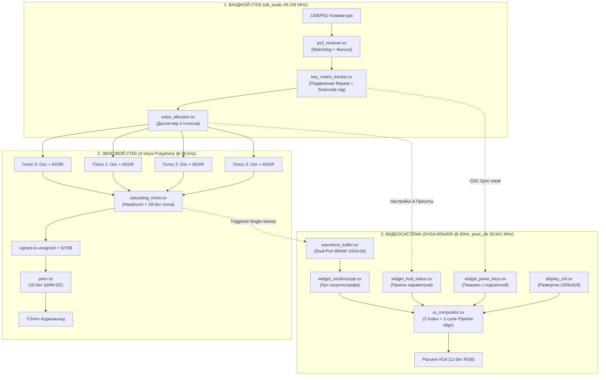

# МАСТЕР-ПЛАН И АРХИТЕКТУРНАЯ СПЕЦИФИКАЦИЯ: ПОЛИФОНИЧЕСКИЙ СИНТЕЗАТОР И UI-СТАНЦИЯ

**Статус:** Согласованная архитектурная спецификация  
**Целевая платформа:** Digilent Nexys A7-100T (Xilinx Artix-7 `xc7a100tcsg324-1`)  
**Язык реализации:** Чистый синтезируемый SystemVerilog (IEEE 1800-2012)  
**Устройства ввода-вывода:** Стандартная USB-клавиатура (через встроенный PIC24 / PS2 пины F4/B2) $\rightarrow$ FPGA $\rightarrow$ Наушники (3.5 мм ШИМ 0/Z) + Монитор (SVGA 800×600 @ 60 Гц, `pixel_clk = 39.941 МГц`)

---

## 1. Концепция системы

Проект реализует **аппаратный 4-голосный полифонический синтезатор** с полноценным графическим интерфейсом на VGA-мониторе, управляемый со стандартной компьютерной клавиатуры.



---

## 2. Продуманная раскладка обычной клавиатуры

Обычная клавиатура одновременно выполняет две роли: **музыкальные клавиши** (игра аккордами двумя руками) и **панель управления синтезатором** (горячие клавиши настроек).

### 2.1. Музыкальные клавиши (Диапазон 2 октавы):
```
[Черные клавиши / Диезы]:      W   E       T   Y   U       O   P
                              C#4 D#4     F#4 G#4 A#4     C#5 D#5
[Белые клавиши / Ноты]:     A   S   D   F   G   H   J   K   L   ;   '
                            C4  D4  E4  F4  G4  A4  B4  C5  D5  E5  F5
```

### 2.2. Горячие клавиши настроек синтезатора:

| Клавиша(и) | Параметр синтезатора | Значения / Действие |
|---|---|---|
| **F1 .. F4** | **Форма волны (Waveform)** | `F1`: Синус, `F2`: Пила, `F3`: Треугольник, `F4`: Квадрат |
| **1 .. 4** (цифры) | **Пресет огибающей ADSR** | `1`: Пианино, `2`: Скрипка/Пад, `3`: Плек/Чиптюн, `4`: Орган |
| **Z / X** | **Сдвиг базовой октавы** | `Z`: Октава вниз (C3..), `X`: Октава вверх (C5..) |
| **- / =** (плюс/минус)| **Мастер-громкость** | 16 уровней громкости (0 .. 15) |
| **Пробел (Space)** | **Педаль сустейна (Sustain)** | Удерживает звучание нот после отпускания клавиш |
| **M** | **Mute (Без звука)** | Мгновенное глушение звука (AUD_SD = 0) |
| **Tab** | **Режим полифонии** | Переключение: Полифония (4 голоса) $\leftrightarrow$ Монофония (Соло) |
| **R** | **Сброс настроек (Reset)** | Возврат к дефолту (Синус, Пресет 1, Октава 4, Громкость 12) |

---

## 3. Решения краевых условий и аппаратная специфика платы

### 3.1. Входной стек клавиатуры (`ps2_receiver.sv` и `key_matrix_tracker.sv`)
1. **Сторожевой таймер рассинхронизации (Framing Watchdog):**
   * Если пауза между фронтами `PS2_CLK` превышает 200 мкс (горячее подключение, помеха на линии), счетчик бит сбрасывается в 0 (состояние ожидания стартового бита).
2. **Подавление автоповтора (Typematic Repeat Suppression):**
   * Клавиатуры при удержании шлют повторные Make-коды. Трекер клавиш проверяет текущую битовую маску: если клавиша уже зажата, повторный Make-код игнорируется, предотвращая ложный перезапуск ADSR и вытеснение голосов.
3. **Защита от зависания нот при смене октавы (Stuck Note Immunity):**
   * Голос в `voice_allocator` привязывается к физическому коду клавиши (scancode), а не к динамическому номеру октавы. Если нота зажата, октава переключена с `Z/X`, а затем клавиша отпущена — освобождается именно звучащий голос, исключая бесконечное гудение.

### 3.2. Математика микшера и сопряжение с PWM
1. **Суммирование 4 голосов:**
   * 4 голоса со знаком (`signed [15:0]`) складываются в расширенной 18-битной сетке: $4 \times 32767 = 131068$.
   * Применяется жесткий ограничитель (Saturating Limiter): если сумма $> +32767$, значение фиксируется на $+32767$; если $< -32768$, на $-32768$.
2. **Преобразование в беззнаковый ШИМ:**
   * Модуль `pwm.sv` сравнивает беззнаковый счетчик с порогом `duty`. Для правильного центрирования ноль аудиосигнала переводится в середину шкалы:
     $$unsigned\_sample = signed\_sample + 16'sd32768$$
   * Старшие 10 бит `unsigned_sample[15:6]` поступают в ШИМ.
3. **Аппаратная электробезопасность `AUD_PWM`:**
   * Сигнал формируется строго в режиме Open-Drain (`assign AUD_PWM = p ? 1'bz : 1'b0;`). Выдача единицы `1'b1` запрещена.

### 3.3. Развертка осциллографа: Ждущий захват (Triggered Single-Sweep)
* **Проблема постоянного сброса:** Сброс адреса записи по каждому zero-crossing (440 Гц = каждые 2.2 мс) при буфере на 800 отсчетов (16.6 мс) заполняет только первые 109 ячеек, оставляя остальную часть экрана пустой.
* **Решение:** Автомат ждущей развертки (Triggered Single-Sweep):
  1. По сигналу готовности кадра от видеоконтроллера (после VSYNC) автомат переходит в режим ожидания перехода через ноль (`zero-crossing` басовой ноты).
  2. При обнаружении триггера запускается непрерывная запись ровно 800 точек в буфер.
  3. По завершении 800 сэмплов запись замораживается на весь период отображения текущего кадра. Изображение на мониторе стабильно, не мерцает и развернуто на всю ширину окна осциллографа.

---

## 4. Карта графического интерфейса (SVGA 800×600 @ 60 Гц)

Контроллер развертки `display_ctrl.sv` тактируется от `pixel_clk = 39.941 МГц` (VCO / 16).

```
┌────────────────────────────────────────────────────────────────────────┐
│ [1] HEADER HUD (Y: 0..60)                                              │
│  POLY-SYNTH 4V | WAVE: [SAWTOOTH] | ADSR: [PIANO] | OCT: 4 | VOL: 80%  │
│  ACTIVE NOTES: [ C4 ] [ E4 ] [ G4 ] [ -- ]     SUSTAIN: [OFF]          │
├────────────────────────────────────────────────────────────────────────┤
│ [2] OSCILLOSCOPE WINDOW (Y: 65..360, X: 40..760)                       │
│  ┌──────────────────────────────────────────────────────────────────┐  │
│  │                     (Координатная сетка 0x223)                   │  │
│  │            /\  /\            /\  /\                              │  │
│  │  ─────────/──\/──\──────────/──\/──\────────── (Неоновый луч)    │  │
│  │                   \/  \/             \/  \/                      │  │
│  └──────────────────────────────────────────────────────────────────┘  │
├────────────────────────────────────────────────────────────────────────┤
│ [3] PIANO ROLL (Y: 375..530, X: 50..750)                               │
│   ┌─┬─┬─┬─┬─┬─┬─┬─┬─┬─┬─┬─┬─┬─┬─┬─┬─┬─┬─┬─┬─┬─┬─┐                      │
│   │ │█│ │█│ │ │█│ │█│ │█│ │ │█│ │█│ │ │█│ │█│ │ │ (Подсветка активных  │
│   │ └┬┘ └┬┘ │ └┬┘ └┬┘ └┬┘ │ └┬┘ └┬┘ │ └┬┘ └┬┘ │   всех 4-х нот!)      │
│   └──┴───┴──┴──┴───┴───┴──┴──┴───┴──┴──┴───┴──┴─┘                      │
├────────────────────────────────────────────────────────────────────────┤
│ [4] FOOTER HELP STRIP (Y: 545..595)                                    │
│  [A-']: Play Notes | [F1-F4]: Wave | [1-4]: ADSR | [Z/X]: Oct | [M]:Mute│
└────────────────────────────────────────────────────────────────────────┘
```

---

## 5. Дорожная карта сквозной реализации

### Этап 1: Входной полифонический стек
* **Файлы:** `ps2_receiver.sv`, `key_matrix_tracker.sv`, `voice_allocator.sv`.
* **Результат:** Прием скан-кодов с пинов F4/B2 с подавлением дребезга и тайм-аутом, фильтрация typematic repeat, диспетчеризация до 4 одновременных нот.

### Этап 2: 4-голосный звуковой движок
* **Файлы:** `oscillator_core.sv`, `adsr_envelope.sv`, `saturating_mixer.sv`, `synth_engine.sv`.
* **Результат:** 4 голоса с выбором волны (синус, пила, треугольник, меандр) и ADSR огибающими, суммирование в `saturating_mixer.sv`, вывод в `pwm.sv` со смещением в беззнаковую шкалу.

### Этап 3: Междоменный буфер волны
* **Файлы:** `waveform_buffer.sv` (Dual-Port BRAM 1024x16).
* **Результат:** Безопасный переход из звукового домена (49.159 МГц) в видеодомен (39.941 МГц), ждущий захват 800 сэмплов по zero-crossing.

### Этап 4: Графический интерфейс и компоновщик UI
* **Файлы:** `widget_hud_status.sv`, `widget_oscilloscope.sv`, `widget_piano_keys.sv`, `ui_compositor.sv`.
* **Результат:** Beam Racing рендеринг на `display_ctrl.sv` 800×600 @ 60 Гц с выравниванием задержки конвейера (1 такт).

### Этап 5: Сборка верхнего уровня и верификация
* **Файлы:** `src/top/audio_nexys_a7.sv`, `audio_nexys_a7.xdc`.
* **Результат:** Полная интеграция, успешная симуляция всех подсистем, синтез в Vivado с выполнением таймингов.
