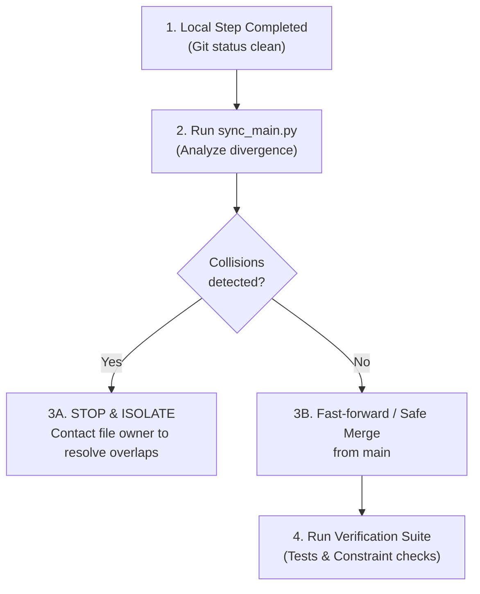

# Main Branch Synchronization & Conflict Prevention Skill

This skill ensures that feature and agent development branches (such as `harness(develop)`) stay continuously synchronized with `main` without regressions or overwriting other teammates' edits.

## When to Use This Skill
- Immediately after finishing any logically complete step or module fix.
- Before preparing a pull request or submitting code to the Integrator.
- When notified that new commits have been pushed to `main`.

## Operational Workflow



## Protocol Steps

1. **Verify Local Tree**:
   Ensure all local changes are staged or committed in the feature branch. Never run sync on a dirty working tree.

2. **Run Divergence Analysis**:
   ```bash
   python -m harness.tools.sync_main
   ```
   Inspect the JSON output:
   - `files_modified_in_main`: files touched on `main` since the branch point.
   - `colliding_files`: files modified by BOTH your branch and `main`.

3. **Collision Triage**:
   - If `colliding_files` is NOT empty:
     * **HALT**. Do not force merge or rebase.
     * Identify who modified the file on `main` (via `git log <file>`).
     * Adhere to the **One Owner Per File** rule defined in `doc/AGENT_TASKS.md`. Shared files (`top.sv`, `deploy.tcl`, `audio_nexys_a7.xdc`) are strictly owned by the Integrator.
   - If `safe_to_sync` is `true`:
     * Execute sync or rebase.

4. **Post-Sync Verification**:
   Execute the baseline test suite immediately after syncing:
   ```bash
   python -m unittest discover -s tests -p "test_*.py"
   ```
